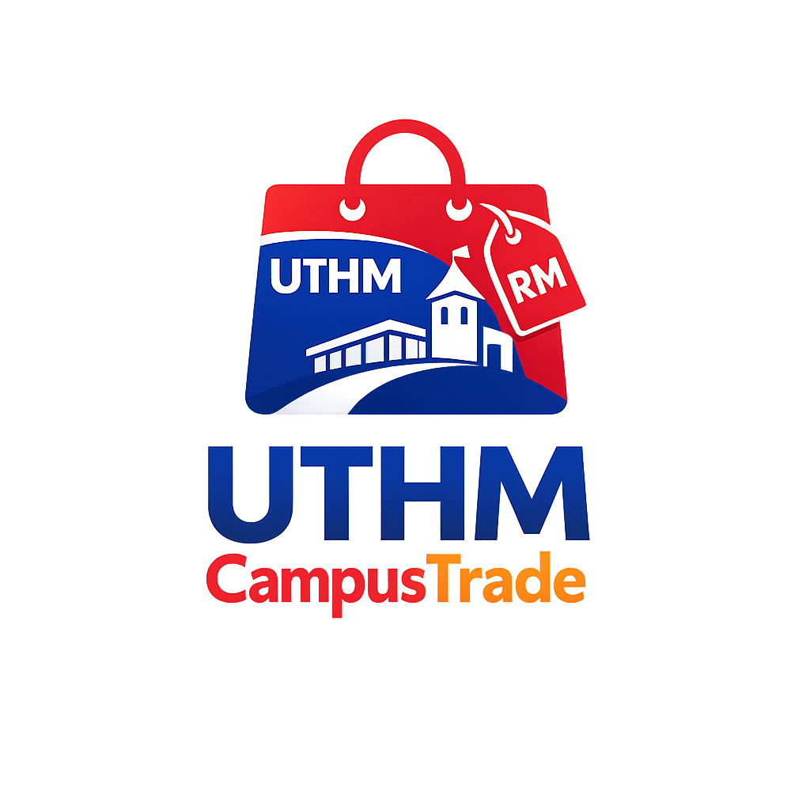
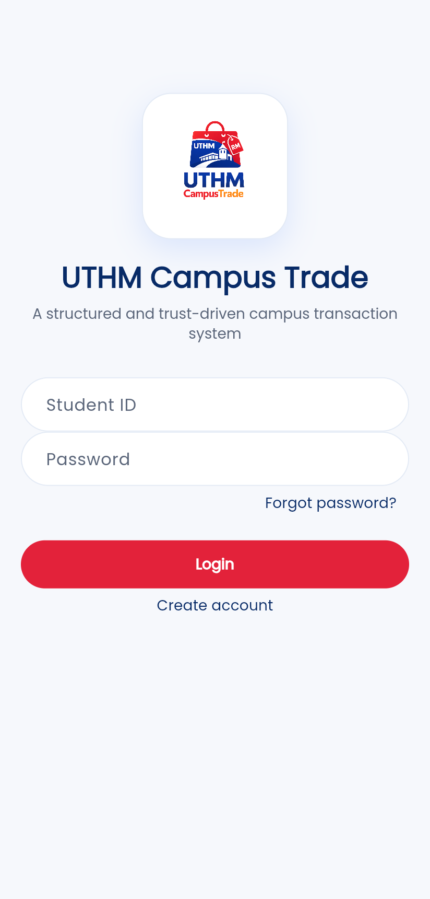
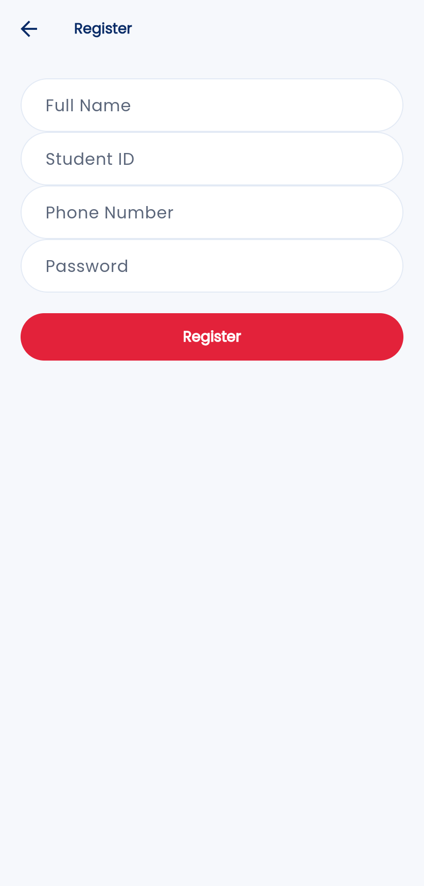

<div align="center">



# UTHM CampusTrade

**A structured, trust-driven campus marketplace for Universiti Tun Hussein Onn Malaysia (UTHM) students.**

[](https://qaid-u.github.io/UTHM-CampusTrade-A-Structured-and-Trust-Driven-Campus-Transaction-System/)


</div>

UTHM CampusTrade replaces unorganized trading through messaging apps and social media with a centralized system that supports verified users, structured transactions, real-time communication and safe meetup coordination.

## 📱 Demo

**Try it in your browser:** [qaid-u.github.io/UTHM-CampusTrade-A-Structured-and-Trust-Driven-Campus-Transaction-System](https://qaid-u.github.io/UTHM-CampusTrade-A-Structured-and-Trust-Driven-Campus-Transaction-System/) (Flutter web build, deployed by GitHub Actions to GitHub Pages).

<table align="center">
  <tr>
    <td align="center" width="50%"><br><sub><b>Login</b><br>Student ID + password, forgot password, create account</sub></td>
    <td align="center" width="50%"><br><sub><b>Register</b><br>New student account sign-up</sub></td>
  </tr>
</table>

> Login uses Firebase Authentication (the app maps a student ID to `studentId@student.uthm.edu.my`), so you need a UTHM student account to see the marketplace screens.

## 🚀 Project Objectives

- Develop a structured campus-based marketplace for UTHM students
- Improve trust and accountability in student-to-student trading
- Provide a clear transaction workflow from listing to completion
- Reduce unsafe and uncoordinated physical meetups
- Promote sustainable reuse of items within the campus community

## 🧩 Features

Verified against the source in `lib/`:

- **Authentication** - Firebase Auth login, registration and password reset (`login_screen`, `register_screen`, `auth_service`)
- **Marketplace** - create item listings, browse with search, item detail with seller info (`add_item_screen`, `home_screen`, `item_detail_screen`)
- **Offers and transactions** - offer-based workflow, transaction history screen, status tracking (`offer_service`, `transaction_service`, `transaction_history_screen`)
- **Meetup coordination** - pick a meetup location with Google Maps, geolocator and geocoding (`meetup_location_screen`)
- **Real-time chat** - buyer/seller chat rooms and chat list (`chat_screen`, `chats_screen`, `chat_service`)
- **Trust and reviews** - reviews and a trust score calculated as 60% average rating, 20% completed transactions, 20% cancellation performance (`trust_score_service`, `review_service`, `seller_profile_screen`)
- **Notifications** - Firebase Cloud Messaging plus local notifications (`fcm_service`, `notification_screen`)
- **Premium subscription** - monthly/yearly premium state and badge (`premium_screen`, `subscription_service`); the payment gateway layer (`payment_service`) is an abstract interface for future gateways
- **Bottom navigation** - Home, Chats, Transactions, Profile

## 🏗️ Architecture

```
UI Layer (screens, widgets)
        ↓
Service Layer (business logic)
        ↓
Firebase (Authentication, Firestore, Storage, Messaging)
```

## 🔥 Tech Stack

| Area | Tools |
|---|---|
| Frontend | Flutter, Dart, google_fonts, cached_network_image |
| Backend | Firebase Authentication, Cloud Firestore, Firebase Storage, Firebase Cloud Messaging |
| Maps and location | google_maps_flutter, geolocator, geocoding |
| Media | image_picker, image_cropper, image |
| Other | url_launcher, flutter_local_notifications, http, audioplayers |
| CI/CD | GitHub Actions deploys the web build to GitHub Pages |

## 🗄️ Firestore Structure (overview)

```plaintext
users/         name, email, reputation
items/         title, description, price, sellerId, sellerName, imageUrl, status (available | sold), createdAt
transactions/  itemId, buyerId, sellerId, status (pending | accepted | cancelled | completed),
               meetupLocation, lat, lng, createdAt
```

Security rules are in `firestore.rules` and `storage.rules`.

## ⚙️ Quick Start

Requirements: Flutter SDK (stable), Android Studio or VS Code, Android SDK 35+, a Firebase project and a Google Maps API key.

```bash
git clone https://github.com/qaid-u/UTHM-CampusTrade-A-Structured-and-Trust-Driven-Campus-Transaction-System.git
cd UTHM-CampusTrade-A-Structured-and-Trust-Driven-Campus-Transaction-System
flutter pub get
```

1. Create a Firebase project and enable Email/Password Authentication, Cloud Firestore, Storage and Cloud Messaging.
2. Add `google-services.json` to `android/app/`.
3. Add your Google Maps API key (see [GOOGLE_MAPS_API_SETUP.md](GOOGLE_MAPS_API_SETUP.md)).
4. Run:

```bash
flutter run                # connected device or emulator
flutter build web --release   # web build, as used for the live demo
```

Full instructions: [SETUP_GUIDE.md](SETUP_GUIDE.md).

## 📂 Project Structure

```
lib/
  constants/   app defaults
  models/      user, item, offer, transaction, chat room, message, review, notification
  screens/     login, register, home, item detail, add item, chats, meetup, transactions, profile, premium, ...
  services/    auth, item, offer, transaction, chat, review, trust score, FCM, subscription, storage, ...
  theme/       app theme
  widgets/     reusable cards, chips, badges, chat bubbles
docs/screenshots/   README screenshots
firestore.rules, storage.rules
```

## ⭐ Future Improvements

- Payment gateway integration
- AI-based item recommendation
- Advanced fraud detection

## 👨‍💻 Project Members

- Muhammad Qaid Uqail Bin Khairul Anuar
- Muhammad Danial Bin Shaharuddin
- Ezamirul Syakir Bin Shekh Abdul Halim
- Muhammad Rusydi Bin Md Rahfee
- Hazman Irfan Bin Ahsan
- Aiman Afiq Bin Azman

Faculty of Computer Science and Information Technology, Universiti Tun Hussein Onn Malaysia (UTHM).

## 📄 License

Developed for academic purposes under UTHM coursework requirements.
